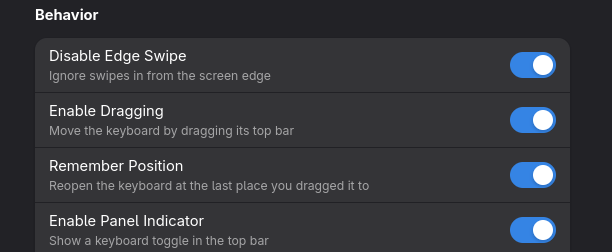
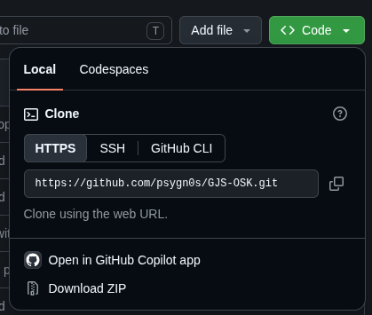

# Fedora 45 / GNOME 51 Fix for GJS-OSK Extension

This fix addresses compatibility issues with the **GJS-OSK** GNOME Shell extension on Fedora 45 running GNOME 51.

## Updates.

Update 1: Fixed entering system password bug.
<br>
<br>
Update 2: Fixed file renaming bug present in original GJS-OSK release.
<br>
<br>
Update 3: Added "Remember Window Position" switch in GJS-OSK settings.



## Installation.

1. Download the whole zip file from this repository.




2. Open a terminal and navigate to your GJS-OSK extension directory:
```bash
cd ~/.local/share/gnome-shell/extensions/gjsosk@vishram1123.com/
```

3. Back up your existing files (optional):
```bash
cp extension.js extension.js.backup
cp prefs.js prefs.js.backup
cp schemas/org.gnome.shell.extensions.gjsosk.gschema.xml schemas/org.gnome.shell.extensions.gjsosk.gschema.xml.backup
```

4. Extract downloaded zip file and replace existing files in
```bash
~/.local/share/gnome-shell/extensions/gjsosk@vishram1123.com/
```

5. Recompile the schemas.
```bash
glib-compile-schemas ~/.local/share/gnome-shell/extensions/gjsosk@vishram1123.com/schemas/
```

6. Re-log your system:

```bash
sudo logout
```

After relogging, GJS-OSK should load the updated extension.

## Restore the Original Files.

If you encounter problems, restore your backup:

```bash
cd ~/.local/share/gnome-shell/extensions/gjsosk@vishram1123.com/
mv extension.js.backup extension.js
mv prefs.js.backup prefs.js
mv schemas/org.gnome.shell.extensions.gjsosk.gschema.xml.backup org.gnome.shell.extensions.gjsosk.gschema.xml
glib-compile-schemas ~/.local/share/gnome-shell/extensions/gjsosk@vishram1123.com/schemas/
```

Then relog.


## Disclaimer

This is an unofficial community compatibility fix. Always keep a backup of your original extension files before making changes.
